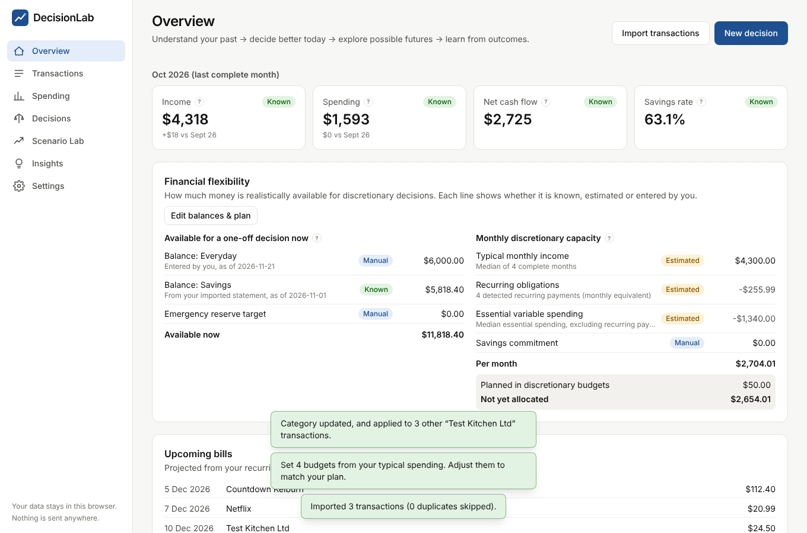
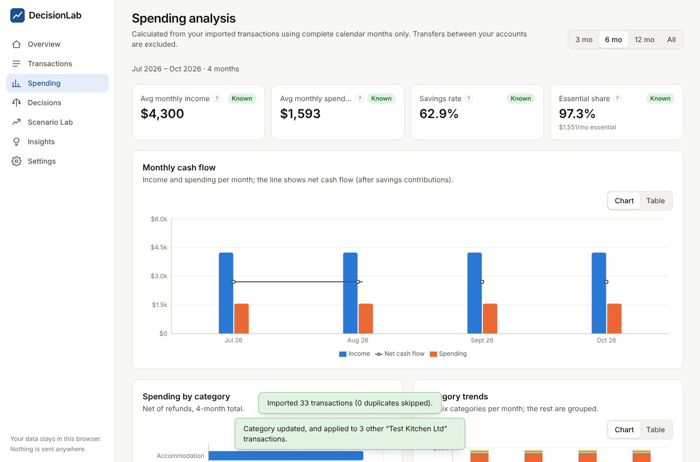
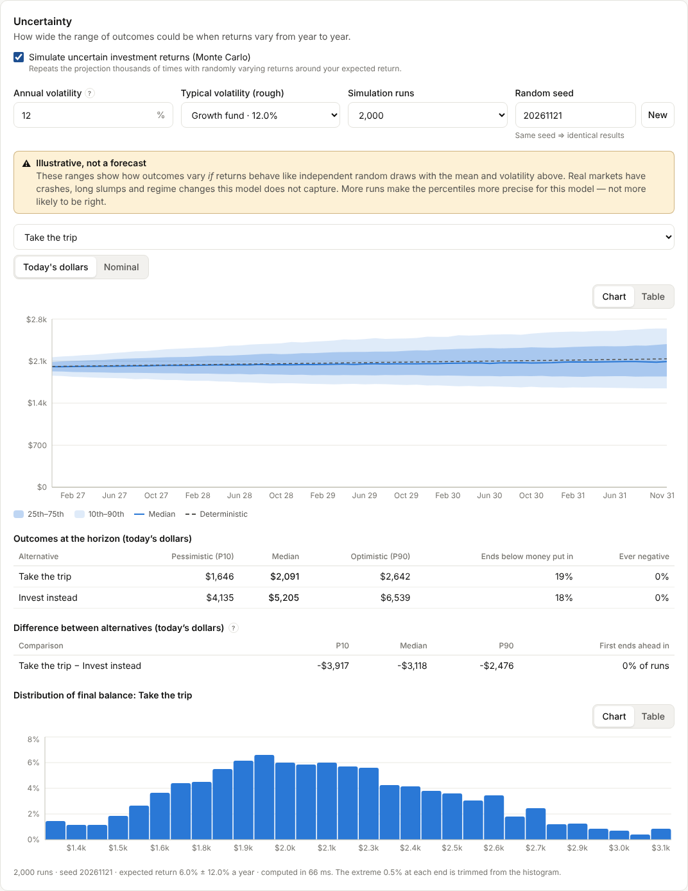
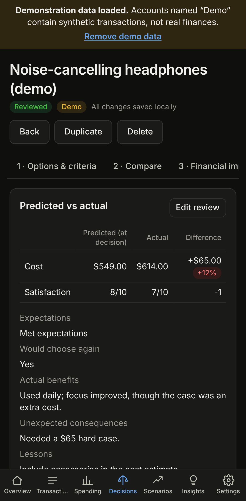

# DecisionLab

**Personal financial intelligence and decision-making laboratory.** Local-first, private, and built around one loop:

> Understand your past → make better decisions today → explore possible futures → learn from actual outcomes.

DecisionLab combines three connected tools:

| Module | What it does |
| --- | --- |
| **SpendLens** | Import bank CSVs, categorise transactions with rules, analyse cash flow, spending, recurring payments and budgets, and estimate how much you can realistically spend. |
| **ChoiceLedger** | Structure decisions: alternatives, weighted criteria (direct or by pairwise comparison), a transparent score, a cost-vs-preference chart, sensitivity to your weights, a frozen record of your reasoning, and later outcome reviews. |
| **FutureRegret** | Deterministic projections (compound growth, contributions, fees, tax, inflation) and optional Monte Carlo ranges to compare the financial consequences of alternatives, with sensitivity analysis. |

All data stays in your browser (IndexedDB). There is no server, account, analytics or tracking.



## Quick start

Requires Node.js 20+ (developed on Node 22).

```bash
npm install
```

```bash
npm run dev
```

Open the printed URL (usually http://localhost:5173). On first launch, either **Import CSV** with a statement from your bank, or **Load demo data** to explore a clearly labelled synthetic dataset (removable in one click).

### Other commands

| Command | Purpose |
| --- | --- |
| `npm test` | Unit, data-layer and component tests (Vitest, 170 tests) |
| `npm run typecheck` | TypeScript strict type check |
| `npm run build` | Type check + production build into `dist/` |
| `npm run preview` | Serve the production build locally (enables offline/PWA support) |
| `npm run e2e` | End-to-end test of the full workflow plus an axe accessibility audit in headless Chromium (run `npm run build` first; `SCREENSHOTS=1` refreshes `docs/screenshots`) |

The production build is a static site: you can serve `dist/` from any static host or local file server. Routing uses URL hashes, so no server rewrites are needed. On Android, open it in Chrome and choose **Add to Home screen** to install it as an app.

## Using DecisionLab

1. **Import transactions** (Transactions → Import CSV). Choose the file and account, confirm the suggested column mapping (date format, signed amount or debit/credit columns, description columns), review the preview (new / duplicate / error rows), then import. Exports from ASB, ANZ, BNZ, Westpac and Kiwibank are recognised automatically (presets are not yet verified against real files — see [docs/BANK_PRESETS.md](docs/BANK_PRESETS.md)). If the statement has a balance column, DecisionLab reads your balance from it and checks that the running balance adds up. Every import can be undone from *Import history*. The original CSV values are kept on each transaction for auditing.
2. **Categorise.** Default rules cover common NZ merchants. Change a category in the table and, with “apply to the same merchant” ticked, DecisionLab remembers it. Manual choices are never overwritten. Manage rules (order, enable/disable, regex) under *Categorisation rules*. Mark transfers between your accounts as **Transfers** so they are not counted as spending or income. Open a transaction to **split** it across categories, add notes, or link it to a decision; use **Add transaction** for cash.
3. **Analyse** (Spending). Budgets (start from your typical spending, then see each month whether you are on pace — bills count on their due dates), account balance history, recurring payments you can confirm, rename or re-price, monthly cash flow, spending by category, trends, period comparisons (a month vs the previous three, or any two date ranges), recurring payments and unusually large transactions, all from complete calendar months.
4. **Set your plan** (Settings). Enter account balances, an emergency reserve, savings commitment, upcoming expenses and goals (a goal can track an account's balance). The Overview then shows **money available now** (after bills due before your next pay) and **monthly discretionary capacity**, plus upcoming bills, with each line marked *Known*, *Estimated* or *Manual*.
5. **Make a decision** (Decisions → New decision). Add alternatives with upfront/ongoing costs, criteria with weights (or *Compare in pairs…* to derive them), and scores. *Compare* shows the transparent weighted score and whether the ranking is fragile. *Financial impact* projects each alternative’s effect on your savings, with opportunity cost, a sensitivity (tornado) analysis and optional **Monte Carlo** ranges for uncertain returns. *Decide* records your choice, reasoning, predicted satisfaction and review date as an immutable snapshot.
6. **Review outcomes** when the review date arrives (shown on the Overview). Link the real payments so the actual cost is measured from your data, then record what actually happened; DecisionLab compares prediction with reality. *Insights* summarises calibration across decisions — always with sample sizes.
7. **Explore** freely in the *Scenario Lab* (spend vs invest, buy now vs later, savings-rate changes, recurring costs, working fewer hours). Turn a scenario into a decision with one click, or open a decision's alternatives in the Lab. Use a goal as the target to see whether it is reached in time.
8. **Reminders**: the Decisions menu shows how many reviews are due; optionally turn on a daily reminder notification (Settings → Reminders & appearance).
9. **Back up** regularly (Settings → Data & privacy). Encrypted backups use AES-256-GCM with a passphrase.

## Screenshots

| Spending analysis | Monte Carlo ranges | Mobile (dark) |
| --- | --- | --- |
|  |  |  |

All screenshots use synthetic data.

## Project documentation

- [Architecture](docs/ARCHITECTURE.md): structure, module boundaries, technology choices and their rationale
- [Data model](docs/DATA_MODEL.md): entities, storage schema and migration rules
- [Calculations](docs/CALCULATIONS.md): definitions and conventions behind every number
- [Bank CSV presets](docs/BANK_PRESETS.md): supported layouts and how to verify them
- [Privacy & security](docs/PRIVACY.md): what is stored where, limitations of browser storage, backups
- [Status](docs/STATUS.md): implemented versus planned functionality
- [Backlog](docs/BACKLOG.md): prioritised future work
- [AGENTS.md](AGENTS.md): conventions for contributors and coding agents (Codex)

## Important caveats

DecisionLab is a personal analysis tool, not financial advice. Projections are **illustrative** results of the assumptions you enter; investment returns are uncertain and not guaranteed. Preference scores reflect your own weights and are not an objective measure of what is “best”.
