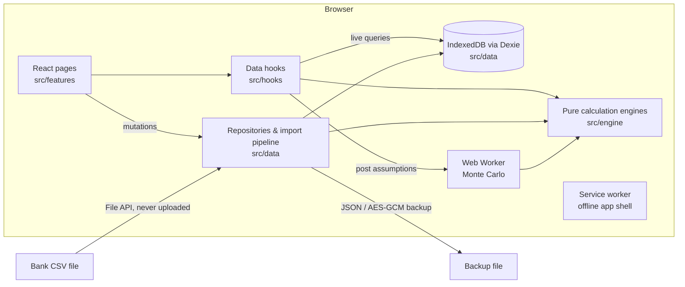
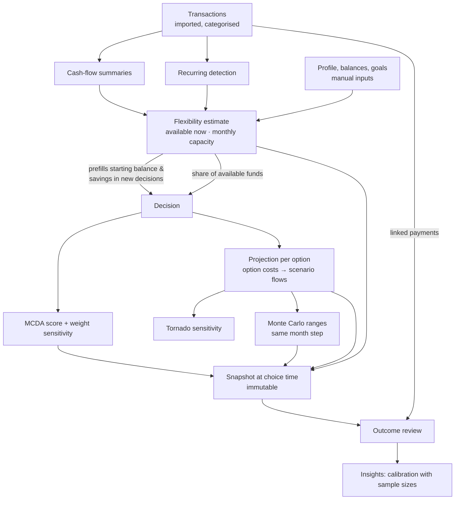

# Architecture

DecisionLab is a **browser-only, local-first single-page application**. There is no backend. All computation runs in pure TypeScript modules in the browser, and all data lives in the browser's IndexedDB.

## System overview

## Layers

| Layer | Folder | Responsibility | May import |
| --- | --- | --- | --- |
| Domain | `src/domain` | Entity types, integer-cent money, ISO dates, ids | nothing |
| Engines | `src/engine` | Pure, deterministic calculations | domain |
| Data | `src/data` | Dexie schema, repositories, import pipeline, decision snapshots, backup/encryption, demo dataset | domain, engine |
| Hooks | `src/hooks` | Reactive queries (`useLiveQuery`) + memoised engine results; `useMonteCarlo` runs simulations in a Web Worker | data, engine |
| Workers | `src/workers` | Off-main-thread computation (Monte Carlo) | engine |
| UI | `src/ui` | Accessible primitives, chart conventions, theme, toasts | domain |
| Features | `src/features/*` | Pages: overview, transactions, spending, decisions, scenarios, insights, settings | all of the above |

Engines never touch React, IndexedDB or the clock (`today` is passed in), which is why ~85% of the logic is covered by fast unit tests.

## How the three modules connect

Key shared interfaces:

- **`optionToVariant(option)`** (engine/projection) turns a decision alternative's upfront and monthly costs into scenario cash flows, so decisions and the Scenario Lab use one projection engine.
- **`estimateFlexibility(...)`** (engine/flexibility) is used by the Overview, decision financial tab and snapshot.
- **`DecisionSnapshot`** freezes options, criteria, scores, ranking, assumptions, projected financials, available funds and predictions when a choice is recorded.

## Technology choices

| Choice | Why | Alternatives considered |
| --- | --- | --- |
| **React 19 + TypeScript (strict) + Vite** | Familiar, fast, typed; Vite gives instant dev server and static builds | — |
| **Tailwind CSS v4** with semantic CSS-variable tokens | Consistent light/dark theming from one token set | CSS modules |
| **In-house UI primitives** (native `<dialog>`, `<select>`, radio groups) | Accessibility for free, no large dependency | Radix/shadcn: good, but adds many packages for a small app |
| **Recharts** | Declarative, adequate for bar/line charts; every chart also has a table view | ECharts (heavier), D3 (more code) |
| **Dexie (IndexedDB)** + `dexie-react-hooks` | Versioned schema, transactions, live queries | localStorage (too small, synchronous), SQLite-WASM (heavier; consider for a desktop version) |
| **PapaParse** | Robust CSV parsing (quotes, embedded commas, BOMs) | Hand-written parser (error-prone) |
| **zod** | Validates backups before restoring | Manual checks |
| **Web Crypto** | AES-256-GCM + PBKDF2 for encrypted backups with no dependency | libsodium (extra dependency) |
| **Hash router** | Works on any static host or folder without rewrites | Browser history routing |
| **Hand-written service worker** | Offline app shell in ~60 lines | vite-plugin-pwa/Workbox (heavier) |
| **No Python backend** | Every MVP requirement (incl. future Monte Carlo) runs comfortably in the browser; a backend would add hosting, auth and privacy surface | FastAPI + NumPy: reconsider only for heavy analytics |

Runtime dependencies: react, react-dom, react-router-dom, dexie, dexie-react-hooks, recharts, papaparse, zod.

## Key design decisions

1. **Integer cents for ledger money.** All persisted and summed amounts are safe integers. Projection models compute in fractional cents and round only at outputs.
2. **Calendar dates as strings.** Bank dates are local calendar dates; storing them as `YYYY-MM-DD` avoids time-zone shifts across month boundaries.
3. **Category kind drives accounting.** `income`, `expense`, `transfer`, `savings`. Transfers and savings contributions never count as spending, preventing double counting.
4. **Categorisation precedence:** manual > learned merchant memory > ordered rules > uncategorised. Manual choices are never overwritten.
5. **Duplicate detection with occurrence indices** so overlapping statements import only new rows while genuine identical purchases are kept.
6. **Money is not silently mixed into preference scores.** The weighted score covers subjective/measured criteria; costs and projections are shown side by side, with a Pareto (“efficient/dominated”) indicator.
7. **Immutable decision snapshots.** Decisions store their own copy of assumptions; recording a choice freezes a snapshot. Reopening moves it to `snapshotHistory`.
8. **Provenance everywhere.** Values are tagged *Known* (computed from data), *Estimated* (inferred) or *Manual* (entered).
9. **One month-step function** (`stepMonth`) shared by the deterministic and Monte Carlo engines, so both apply identical timing, fee and tax conventions; Monte Carlo with zero volatility reproduces the deterministic projection exactly (tested).
10. **Split-aware analytics**: category analytics run on analysis lines (split parts or whole transactions), never directly on transactions.
11. **Route-based code splitting** per page keeps the initial bundle small; charts load with the pages that use them.

## Technical risks and mitigations

| Risk | Mitigation |
| --- | --- |
| Browser storage eviction or the user clearing site data | `navigator.storage.persist()` requested; status shown in Settings; backup/restore with encryption |
| Bank CSV variety | Configurable mapping, header-row detection, multiple date formats, debit/credit or signed amounts, saved mapping profiles; per-row errors instead of failing the import |
| Recurring detection false positives | Confidence score, “possibly ended” flag, dismiss/restore, manual override of obligations |
| Users reading projections as forecasts | “Illustrative” labelling, nominal vs real toggle, sensitivity analysis, Monte Carlo caveats (independent returns, precision ≠ accuracy), assumptions stored with each decision |
| Spurious insights from little data | Sample sizes on every insight; pattern wording only at n ≥ 5 |
| Schema evolution | Versioned Dexie schema, backup versioning with `migrateBackup`, data-layer tests |

## Testing strategy

- **Unit tests** (`src/**/__tests__`): money/date parsing, CSV mapping, dedupe, categorisation, cash flow, recurring detection, flexibility, scoring and weight sensitivity, projection (checked against closed-form annuity formulas), sensitivity, Monte Carlo (zero-volatility equivalence, seed reproducibility, mean convergence, percentile ordering, common random numbers), splits, decision links, anomalies, calibration.
- **Data-layer tests** with `fake-indexeddb`: import/undo/re-import, memory-based corrections, rule reordering, snapshot immutability, backup round trip, v1 → v2 backup migration, invalid backups, encryption, demo data, manual entry dedupe, splits, decision links.
- **End-to-end** (`scripts/e2e-vertical-slice.mjs`, Playwright): the full import → analyse → decide (incl. Monte Carlo) → manual entry and splits → link actual payments → review workflow in Chromium (17 steps).
