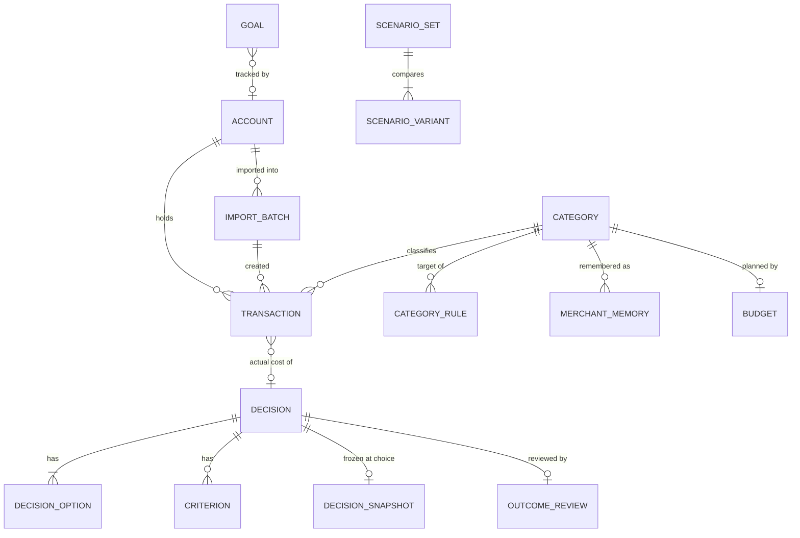

# Data model

Source of truth: [`src/domain/types.ts`](../src/domain/types.ts). Storage: IndexedDB database `decisionlab`, defined in [`src/data/db.ts`](../src/data/db.ts) (schema version 3).

## Conventions

- **Money**: integer cents (`Cents`), e.g. `-8420` = −$84.20. Negative = money out, positive = money in.
- **Dates**: `IsoDate` = `"YYYY-MM-DD"` (local calendar date, no time zone). `MonthKey` = `"YYYY-MM"`. Audit fields (`createdAt`, …) are ISO-8601 instants.
- **Rates**: annual decimals (`0.06` = 6%).
- **Ids**: random UUIDs with a readable prefix (`txn_…`, `dec_…`).

## Entity relationships

## Tables

| Table | Key / indexes | Entity | Notes |
| --- | --- | --- | --- |
| `accounts` | `id` | `Account` | Optional manual `balance {amount, asOf}`; `includeInLiquid` controls flexibility; `isDemo` for synthetic data |
| `categories` | `id`, `sortOrder` | `Category` | `kind`: income / expense / transfer / savings; `essential` for expenses; `archived` instead of deleting used categories |
| `transactions` | `id`, `accountId`, `importId`, `date`, `categoryId`, `merchant`, `fingerprint`, `decisionId` | `Transaction` | `amount` signed cents; `merchant` normalised key; `categorySource`: rule / memory / manual / none; `original` = raw CSV row for audit; optional `splits[]` and `decisionId` |
| `rules` | `id`, `priority` | `CategoryRule` | field (description/merchant), operator (contains/startsWith/equals/regex), direction, optional account; lower priority runs first |
| `merchantMemory` | `merchant` | `MerchantMemory` | Learned from manual corrections; outranks rules |
| `imports` | `id`, `accountId`, `importedAt` | `ImportBatch` | Mapping used, counts, date range; `status: active/undone` (kept after undo for history) |
| `importProfiles` | `id` | `ImportProfile` | Saved CSV column mappings |
| `goals` | `id` | `Goal` | `earmarked` amounts are excluded from available funds; optional `accountId` uses that account's balance as the saved amount |
| `decisions` | `id`, `status`, `date`, `reviewDate`, `updatedAt` | `Decision` | Embeds options, criteria, score matrix, its own `ProjectionAssumptions`, `snapshot`, `snapshotHistory`, `review` |
| `scenarioSets` | `id`, `updatedAt` | `ScenarioSet` | Base assumptions + variants (one-off and recurring flows, contribution change) + optional `monteCarlo` config |
| `settings` | `key` | key–value | `financialProfile`, `defaultAssumptions`, `seeded`, `dismissedRecurring`, `reviewReminders` |
| `budgets` | `categoryId` | `Budget` | `monthlyAmount` (cents) per expense category |

UI-only preferences (theme) are kept in `localStorage`, never financial data.

## Key entities

### Transaction

| Field | Type | Meaning |
| --- | --- | --- |
| `date` | IsoDate | Transaction date from the statement |
| `amount` | Cents | Signed amount |
| `description` | string | Joined description columns |
| `merchant` | string | Normalised key (card numbers, dates, reference codes and payment prefixes removed) |
| `categoryId` / `categorySource` / `ruleId` | | Current category and how it was assigned |
| `fingerprint` | string | `account|date|amount|DESCRIPTION|occurrence` — used for duplicate detection |
| `original` | Record<string,string> | Untouched CSV row |
| `importId` | string \| null | Batch that created it (null = entered manually) |
| `splits` | TransactionSplit[]? | `{id, amount, categoryId, note}` parts summing exactly to `amount`; analytics use these when present |
| `decisionId` | string? | Decision this payment belongs to; used to measure actual cost |

### Decision

- `options[]`: `name`, `upfrontCost` (cents, positive = cost), `costMonth`, `monthlyCost` (may be negative for savings), `monthlyCostMonths`, `expectedBenefits`, `risks`, optional `extraFlows` (one-offs, recurring flows and contribution change, e.g. from a Scenario Lab variant).
- `criteria[]`: `name`, `type` (`rating` 0–10 or `measure`), `direction` (higher/lower is better), `weight` (relative), `unit`.
- `scores[optionId][criterionId]`: number or null.
- `pairwise?`: AHP judgements keyed `"criterionA|criterionB"` (value of A relative to B, 1/9 … 9).
- `assumptions`: the decision's own copy of projection assumptions (not a reference to global defaults).
- `monteCarlo?`: `{enabled, annualVolatility, runs, seed}` for the optional uncertainty simulation.
- `selectedOptionId`, `reasoning`, `predictedSatisfaction` (1–10), `confidence` (1–5), `reviewDate`.
- `snapshot`: `DecisionSnapshot` — deep copy of options, criteria, scores, ranking, assumptions, projected financials per option, available funds, predictions, predicted cost and (if enabled) Monte Carlo P10/median/P90 per option, captured when the choice is recorded. **Never rewritten.**
- `snapshotHistory[]`: earlier snapshots when a choice was reopened before review.
- `review`: actual cost (with `actualCostSource`: `linked` from transactions or `manual`), satisfaction, expectations met, would repeat, benefits, unexpected consequences, lessons.

Status lifecycle: `considering → decided → completed (optional) → reviewed`. Reviewed decisions cannot be reopened (duplicate instead).

### ProjectionAssumptions

`startMonth`, `horizonMonths`, `initialBalance`, `monthlyContribution`, `timing` (`start`/`end`), `annualReturn`, `annualFee`, `taxRateOnReturns`, `annualInflation`, optional `targetAmount` and `goalId`. See [CALCULATIONS.md](CALCULATIONS.md).

## Backups

Format `decisionlab-backup` version 3 (versions 1 and 2 are migrated on restore): `{ format, version, exportedAt, data: { <table>: rows[] } }`. Encrypted backups (`decisionlab-encrypted-backup`) wrap the same JSON: `{ kdf: {PBKDF2, SHA-256, iterations, salt}, cipher: {AES-GCM, iv}, ciphertext }` (base64).

Restore: parse → `migrateBackup` (rejects unknown/newer formats) → zod validation of every row → replace all tables in a single IndexedDB transaction.

## Schema history

| Version | Change | Migration |
| --- | --- | --- |
| 1 | Initial schema | — |
| 2 | `transactions.decisionId` index; optional `splits`, `decisionId`, `monteCarlo`, `actualCostSource` fields | None needed (new fields are optional). Backups v1 → v2 unchanged. |
| 3 | New `budgets` table; optional `pairwise`, `extraFlows`, `goalId`, goal `accountId` | None needed. Backups v2 → v3: empty budgets table. |

## Migrations

1. Add `this.version(n).stores({...}).upgrade(tx => ...)` in `db.ts`; never edit earlier versions.
2. Bump `BACKUP_VERSION` and add an upgrade step in `migrateBackup` for older backup files.
3. Update zod schemas, this document and tests (`src/data/__tests__`).
